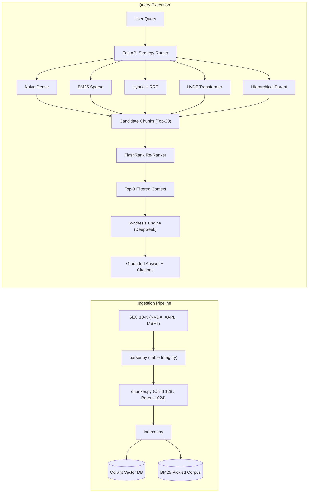

# 🏗️ ARCHITECTURE BLUEPRINT: RAG-Ops Comparative Engine

Dokumen ini adalah **spesifikasi teknis implementasi** untuk LLM / pengembang dalam membangun sistem RAG-Ops secara modular dan decoupled.

---

## 1. Modular Directory Layout

```
H:\coding\Portfolio\RAG_Project\
├── README.md                      # Master Portfolio Overview & Theory
├── ARCHITECTURE.md                # Spesifikasi Teknis & Interface Kontrak
├── EVALUATION_FRAMEWORK.md        # Formula Matematika & Pipeline Ragas
├── HYPERPARAMETERS_GUIDE.md       # Panduan Tuning & Analisis Sensitivitas
├── DATASET_SPEC.md                # Panduan Parsing SEC 10-K & Skema Data
├── .env.example                   # Template Kunci API & Konfigurasi
├── .gitignore                     # Filter file cache & raw data
├── requirements.txt               # Pinning Dependensi Python
├── Dockerfile                     # Deployment Container untuk Render
├── vercel.json                    # Konfigurasi SPA Vercel
│
├── data/
│   ├── raw/                       # File mentah SEC 10-K (NVDA, AAPL, MSFT)
│   ├── processed/                 # File Markdown bersih yang sudah dinormalisasi
│   └── golden_eval_dataset.json   # 50 Ground Truth Q&A Pasangan Uji
│
├── src/
│   ├── __init__.py
│   ├── config.py                  # Pydantic BaseSettings (Model, API Key, Thresholds)
│   ├── ingestion/
│   │   ├── __init__.py
│   │   ├── parser.py              # Parsing HTML/MD 10-K dengan preservasi tabel
│   │   ├── chunker.py             # Small-to-Big (Child: 128 tokens, Parent: 1024 tokens)
│   │   └── indexer.py             # Dual Ingestion: Qdrant (Dense) + BM25 (Sparse)
│   │
│   ├── retrieval/
│   │   ├── __init__.py
│   │   ├── base.py                # Abstract BaseRetriever (Interface Kontrak)
│   │   ├── naive_retriever.py     # dense_search(query, top_k)
│   │   ├── sparse_retriever.py    # bm25_search(query, top_k)
│   │   ├── hybrid_retriever.py    # rrf_fuse(dense_results, sparse_results, k=60)
│   │   ├── hyde_retriever.py      # generate_hypothetical_doc() -> dense_search()
│   │   └── hierarchical_retriever.py # child_search() -> parent_lookup()
│   │
│   ├── reranker/
│   │   ├── __init__.py
│   │   └── flashrank_reranker.py  # Cross-Encoder Re-Ranking (<20ms pada CPU)
│   │
│   ├── generator/
│   │   ├── __init__.py
│   │   └── synthesis_engine.py    # DeepSeek / Gemini Prompting with Citations
│   │
│   └── evaluation/
│       ├── __init__.py
│       ├── metrics.py             # Perhitungan MRR, HitRate, P95 Latency, Cost
│       ├── ragas_evaluator.py     # Wrapper evaluasi Faithfulness & Relevance
│       └── run_benchmark.py       # Script CLI eksekusi 50 query ke 4 metode
│
├── api/
│   ├── __init__.py
│   ├── app.py                     # FastAPI REST API (Endpoints /query, /benchmark)
│   └── schemas.py                 # Pydantic Schemas (Request/Response)
│
└── frontend/
    ├── package.json               # Vite + React + Tailwind + Recharts
    └── src/                       # Komponen A/B Arena & Radar Chart
```

---

## 2. Core Interface Contracts (`src/retrieval/base.py`)

Setiap paradigma retrieval **wajib** mengimplementasikan class abstrak ini agar dapat saling ditukar (*swappable*) di layer API:

```python
from abc import ABC, abstractmethod
from typing import List, Dict, Any
from pydantic import BaseModel

class RetrievedChunk(BaseModel):
    chunk_id: str
    content: str
    score: float
    retriever_origin: str        # 'dense', 'bm25', 'rrf_hybrid', 'hyde', 'parent_doc'
    metadata: Dict[str, Any]     # ticker, year, item_section, table_flag

class BaseRetriever(ABC):
    @abstractmethod
    def retrieve(self, query: str, top_k: int = 5) -> List[RetrievedChunk]:
        """
        Mengembalikan daftar terurut chunk dokumen yang relevan.
        """
        pass
```

---

## 3. Komponen Data Flow & Interaksi



---

## 4. FlashRank Re-Ranker Integration (`src/reranker/flashrank_reranker.py`)

FlashRank dipilih karena menggunakan model Cross-Encoder yang dikompresi (seperti `ms-marco-TinyBERT-L-2-v2` atau `ms-marco-MiniLM-L-12-v2`), yang memiliki karakteristik:
1. **Zero GPU Dependency:** Mampu berjalan di CPU gratis Render dengan latensi hanya **12–25 ms**.
2. **Memory Footprint Rendah:** Membutuhkan RAM `< 100 MB` (sangat aman dari batas 512MB RAM Render Free Tier).
3. **Penyaringan Otomatis:** Menyaring 20 chunk kasar menjadi 3 chunk berkualitas tinggi, menghemat 70% token context ke LLM generator.

---

## 5. Deployment Architecture (Zero-Cost Permanent Free Tier)

1. **Backend (Render Free Web Service):**
   * Menjalankan FastAPI via Uvicorn.
   * Qdrant dapat dijalankan secara embedded di memory/disk lokal atau terhubung ke Qdrant Cloud Free Tier (1GB cluster).
   * BM25 index disimpan dalam file JSON aman (`bm25_index.json`) untuk mencegah celah eksekusi kode berbahaya (CWE-502 Insecure Deserialization).
2. **Frontend (Vercel Free Tier):**
   * Single-Page Application (SPA) React + Tailwind CSS.
   * Memanggil API Render via REST JSON.
   * Auto-deploy dari branch `main` GitHub.

---

## 6. Cybersecurity Defense-in-Depth (OWASP LLM Top 10 - 2026 Standard)

Sistem RAG-Ops dirancang dengan kepatuhan penuh terhadap standar keamanan LLM terkini:

```
┌────────────────────────────────────────────────────────────────────────┐
│               CYBERSECURITY DEFENSE MATRIX (OWASP 2026)                │
├─────────────────────┬───────────────────┬──────────────────────────────┤
│ ANCAMAN CYBER       │ VEKTOR SERANGAN   │ MITIGASI ARSITEKTUR          │
├─────────────────────┼───────────────────┼──────────────────────────────┤
│ 1. Indirect Prompt  │ Dokumen 10-K      │ Isolasi konteks via tag XML  │
│    Injection        │ memuat teks jahat │ <untrusted_context>. LLM     │
│    (OWASP LLM01)    │ tersembunyi.      │ diinstruksikan menolak input │
│                     │                   │ tersebut sebagai kode/aksi.  │
├─────────────────────┼───────────────────┼──────────────────────────────┤
│ 2. Markdown Image   │ LLM dipaksa buat  │ Frontend menyaring/sanitize  │
│    Data Exfil       │ tag gambar:       │ tag  dan menerapkan     │
│    (OWASP LLM02)    │  │ Content Security Policy      │
│                     │ untuk curi data.  │ (CSP: img-src 'self' data:). │
├─────────────────────┼───────────────────┼──────────────────────────────┤
│ 3. Vector Isolation │ Pencarian bocor   │ Penegakan filter metadata    │
│    Weakness         │ ke dokumen ticker │ wajib (ticker_filter) pada   │
│    (OWASP LLM09)    │ yang tidak sah.   │ layer Vector DB sebelum ANN. │
├─────────────────────┼───────────────────┼──────────────────────────────┤
│ 4. Insecure Deseri- │ File pickle BM25  │ Menggunakan serialisasi murni│
│    alization        │ dieksploitasi RCE │ JSON (bm25_index.json) tanpa │
│    (CWE-502)        │ (arbitrary code). │ ketergantungan modul pickle. │
└─────────────────────┴───────────────────┴──────────────────────────────┘
```
