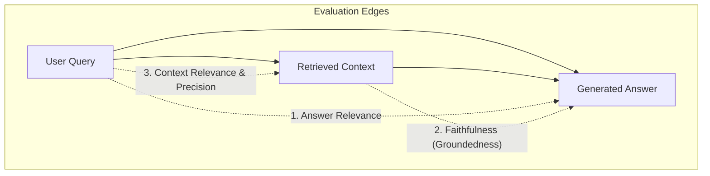

# 📊 EVALUATION FRAMEWORK & METRICS SPECIFICATION

Dokumen ini mendefinisikan seluruh **metodologi evaluasi kuantitatif**, formula matematis, dan algoritma *LLM-as-a-Judge* yang digunakan dalam proyek RAG-Ops.

---

## 1. The RAG Triad Metrics (Ragas & TruLens Standard)



### A. Faithfulness (Anti-Hallucination Metric)
* **Tujuan:** Mengukur apakah setiap klaim fakta yang dibuat oleh LLM generator memiliki bukti eksplisit di dalam konteks yang ditarik.
* **Prosedur Hitung (Algoritmik):**
  1. **Claim Extraction:** LLM evaluator memecah jawaban menjadi daftar proposisi atomik $S = \{s_1, s_2, \dots, s_n\}$.
  2. **Context Verification:** Untuk setiap pernyataan $s_i$, evaluator memeriksa apakah $s_i$ didukung secara logis oleh teks konteks $C$.
  3. **Formula:**
     $$\text{Faithfulness} = \frac{\sum_{i=1}^{n} \mathbb{I}(s_i \text{ didukung oleh } C)}{n}$$
* **Threshold Target:** **$\ge 0.95$ (Wajib Zero Hallucination pada Dokumen Finansial)**.

---

### B. Context Precision (Signal-to-Noise Ratio)
* **Tujuan:** Mengukur apakah chunk yang relevan ditempatkan di peringkat atas, bukan terkubur di bawah chunk sampah.
* **Formula:**
  $$\text{Context Precision@K} = \frac{\sum_{k=1}^{K} \left( \text{Precision@k} \times v_k \right)}{\text{Total chunk relevan dalam Top-K}}$$
  *di mana $v_k \in \{0, 1\}$ mengindikasikan apakah dokumen di peringkat $k$ relevan dengan pertanyaan acuan.*

---

### C. Context Recall (Kelengkapan Informasi)
* **Tujuan:** Mengukur apakah seluruh fakta yang terdapat pada *Ground Truth Answer* manusia berhasil ditemukan oleh retriever.
* **Formula:**
  $$\text{Context Recall} = \frac{|\text{Kalimat acuan dalam Ground Truth yang dapat diverifikasi oleh Context}|}{|\text{Total kalimat dalam Ground Truth}|}$$

---

### D. Answer Relevance
* **Tujuan:** Menghitung relevansi semantik antara jawaban yang digenerate dengan query asli (mencegah jawaban bertele-tele atau menyimpang).
* **Prosedur Hitung:**
  1. LLM evaluator diminta membuat 3 pertanyaan potensial yang mungkin dijawab oleh teks jawaban tersebut ($q_1^*, q_2^*, q_3^*$).
  2. Dihitung rata-rata cosine similarity antara embedding pertanyaan sintesis dengan query asli $q$:
     $$\text{Answer Relevance} = \frac{1}{m} \sum_{j=1}^{m} \text{CosineSimilarity}(E(q), E(q_j^*))$$

---

## 2. Standard Information Retrieval (IR) Metrics

Metrik ini dihitung langsung secara deterministik terhadap **Golden Dataset (Ground Truth Chunks)** tanpa bergantung pada LLM:

### A. Hit Rate @ K
Mengukur apakah minimal satu dokumen acuan yang benar berhasil masuk ke dalam $K$ hasil teratas ($K=3, 5$):
$$\text{Hit Rate@K} = \begin{cases} 1, & \text{jika } \exists d \in \text{Top-K} \cap \text{GroundTruth} \\ 0, & \text{lainnya} \end{cases}$$

### B. Mean Reciprocal Rank (MRR @ K)
Mengukur seberapa cepat sistem menemukan dokumen relevan pertama:
$$\text{MRR} = \frac{1}{|Q|} \sum_{i=1}^{|Q|} \frac{1}{\text{rank}_i}$$
*Jika dokumen relevan pertama berada di ranking 1, skor = $1.0$. Jika berada di ranking 2, skor = $0.5$. Jika tidak ditemukan dalam Top-K, skor = $0.0$.*

---

## 3. Production Operations Metrics (SLA & Cost)

| Metrik | Satuan | Cara Ukur | Target SLA Enterprise |
| :--- | :--- | :--- | :--- |
| **Retrieval Latency** | Milidetik (ms) | `t_retrieval_end - t_query_start` | $\le 40\text{ ms}$ |
| **Re-Ranking Latency** | Milidetik (ms) | `t_rerank_end - t_retrieval_end` | $\le 25\text{ ms}$ (CPU) |
| **Time To First Token (TTFT)** | Milidetik (ms) | Waktu sampai stream token pertama muncul | $\le 600\text{ ms}$ |
| **End-to-End Latency (P95)** | Detik (s) | 95% request selesai di bawah nilai ini | $\le 2.5\text{ detik}$ |
| **Cost per 1,000 Queries** | USD ($) | `(Token Prompt * $0.14 + Token Completion * $0.28) / 1000` | $\le \$0.25$ |

---

## 4. Struktur Data Uji Golden Dataset (`data/golden_eval_dataset.json`)

Setiap item evaluasi dalam golden dataset memiliki skema JSON ketat:

```json
[
  {
    "id": "SEC-NVDA-2024-001",
    "ticker": "NVDA",
    "fiscal_year": "2024",
    "question": "Berapa total pendapatan (revenue) segmen Compute & Networking NVIDIA pada tahun fiskal 2024, dan berapa persentase pertumbuhannya dibanding 2023?",
    "ground_truth_answer": "Pendapatan segmen Compute & Networking NVIDIA pada tahun fiskal 2024 adalah $47,405 juta, tumbuh 217% dibandingkan $15,068 juta pada tahun fiskal 2023.",
    "ground_truth_chunk_ids": ["NVDA_2024_ITEM7_CHUNK_42"],
    "question_type": "factual_numerical",
    "expected_difficulty": "medium"
  }
]
```
