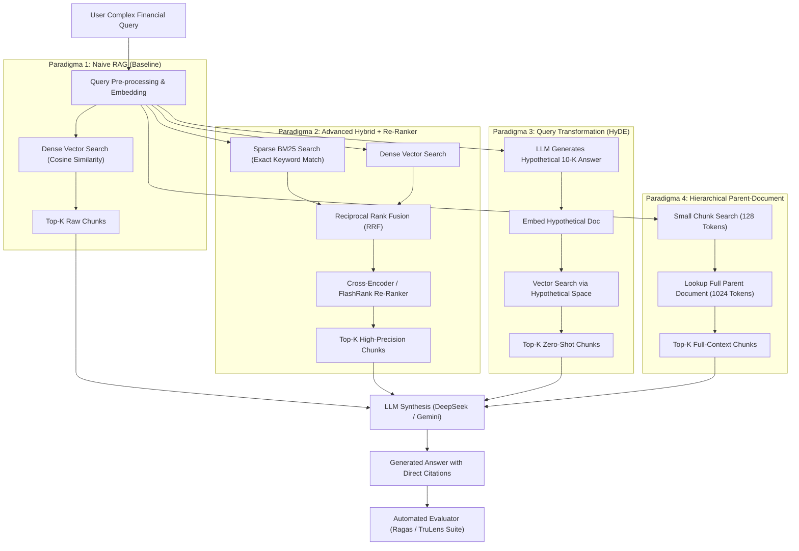
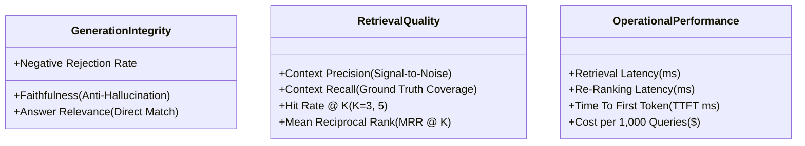
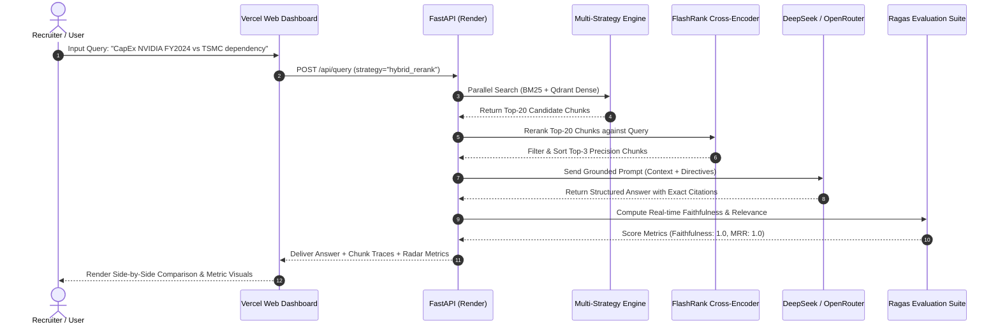

# 🏛️ RAG-Ops: Enterprise Multi-Strategy Retrieval Engine & Quantitative Evaluation Benchmark

> **A Comprehensive Benchmark of Naive, Hybrid (BM25 + Dense RRF), HyDE, and Hierarchical Small-to-Big RAG Architectures Evaluated via the RAG Triad (Ragas / TruLens) over SEC 10-K Financial Filings.**

---

## 📑 Daftar Isi
1. [Executive Summary & Problem Statement](#1-executive-summary--problem-statement)
2. [Teori Mendalam 4 Paradigma RAG](#2-teori-mendalam-4-paradigma-rag)
3. [Algoritma & Landasan Matematis (RRF, BM25, Cross-Encoder)](#3-algoritma--landasan-matematis)
4. [Tabel Parameter Kritis & Tuning Guide](#4-tabel-parameter-kritis--tuning-guide)
5. [Komprehensif Suite Metrik Evaluasi](#5-komprehensif-suite-metrik-evaluasi)
6. [Dataset & Domain Spesifikasi (SEC 10-K)](#6-dataset--domain-spesifikasi)
7. [Arsitektur Sistem & Diagram Alur (Mermaid)](#7-arsitektur-sistem--diagram-alur)
8. [Desain Interaktif Dashboard (A/B Arena & Chunk Inspector)](#8-desain-interaktif-dashboard)
9. [Formulasi Bullet Point CV (Tingkat Senior AI Engineer)](#9-formulasi-bullet-point-cv)
10. [Roadmap Eksekusi Bertahap](#10-roadmap-eksekusi-bertahap)

---

## 1. Executive Summary & Problem Statement

### Mengapa Naive RAG Gagal di Dokumen Finansial Enterprise?
Sebagian besar implementasi RAG di industri saat ini masih berada pada level **"Naive RAG"** (sekadar memotong teks per 500 token, membuat dense embedding, menyimpannya di vector database, dan melakukan cosine similarity search). 

Pada dokumen kompleks seperti **SEC 10-K (Annual Reports)** dari perusahaan teknologi (Apple, Nvidia, Microsoft), Naive RAG mengalami kegagalan fatal karena 3 fenomena:

```
┌────────────────────────────────────────────────────────────────────────┐
│                   3 KEGAGALAN FATAL NAIVE RAG                          │
├───────────────────┬───────────────────┬────────────────────────────────┤
│ 1. VOCABULARY     │ 2. CHUNK          │ 3. LOST IN THE                 │
│    MISMATCH       │    FRAGMENTATION  │    MIDDLE                      │
├───────────────────┼───────────────────┼────────────────────────────────┤
│ Dense embedding   │ Tabel keuangan    │ LLM mengabaikan                │
│ gagal menangkap   │ 30 baris terbelah.│ informasi relevan              │
│ kode akun, nomor  │ Angka kehilangan  │ yang berada di                 │
│ note, & angka     │ konteks header    │ tengah-tengah context          │
│ persis.           │ kolom.            │ prompt yang panjang.           │
└───────────────────┴───────────────────┴────────────────────────────────┘
```

Proyek ini dibangun sebagai **benchmark kuantitatif dan sistem retrieval multi-strategi** untuk membuktikan secara empiris bagaimana teknik-teknik lanjutan (Hybrid Search, Re-ranking, HyDE, dan Hierarchical Retrieval) menyelesaikan ketiga masalah di atas.

---

## 2. Teori Mendalam 4 Paradigma RAG



### 1. Paradigma 1: Naive RAG (The Baseline)
* **Arsitektur:** Recursive Character Text Splitter (500 token, 50 token overlap). Dense embedding tunggal.
* **Karakteristik:** Cepat, murah, namun sangat rentan halusinasi ketika query menanyakan angka spesifik atau klausul hukum di catatan kaki laporan keuangan.

### 2. Paradigma 2: Advanced Hybrid + Re-Ranking (The Industry Standard)
* **Arsitektur:** Menggabungkan **Sparse Search (BM25)** dan **Dense Search (Vector)**. Hasil kedua retriever digabungkan menggunakan algoritma **Reciprocal Rank Fusion (RRF)**, lalu disaring dan diurutkan ulang menggunakan **FlashRank (Miniaturized Cross-Encoder)**.
* **Kelebihan:** Mampu menangkap konsep semantik abstrak sekaligus exact match nomor pasal/angka keuangan secara presisi tinggi.

### 3. Paradigma 3: Query Transformation (HyDE & Multi-Query)
* **Arsitektur:** Menggunakan teknik *Hypothetical Document Embeddings (Gao et al., 2022)*.
* **Mekanisme:** Query pengguna yang singkat (*"Risiko rantai pasok semikonduktor Nvidia di Taiwan"*) terlebih dahulu diubah oleh LLM menjadi draf jawaban hipotetis formal. Embedding dari draf jawaban ini yang kemudian dicocokkan ke dalam database vektor.

### 4. Paradigma 4: Hierarchical / Parent-Document (Small-to-Big)
* **Arsitektur:** Pemisahan antara **Indexing Granularity** vs **Context Granularity**.
* **Mekanisme:** Dokumen dipecah menjadi chunk anak berukuran 128 token (sangat spesifik untuk pencarian vektor), namun metadata chunk anak menyimpan ID dokumen induk (Parent Chunk berukuran 1024 token). Ketika chunk anak cocok, sistem mengembalikan dokumen induk yang utuh ke prompt LLM, mencegah terpotongnya tabel atau kalimat penting.

---

## 3. Algoritma & Landasan Matematis

### A. Algoritma BM25 (Best Matching 25)
BM25 mengukur relevansi leksikal dokumen $D$ terhadap query $Q = \{q_1, q_2, \dots, q_n\}$:

$$\text{Score}(D, Q) = \sum_{i=1}^{n} \text{IDF}(q_i) \cdot \frac{f(q_i, D) \cdot (k_1 + 1)}{f(q_i, D) + k_1 \cdot \left(1 - b + b \cdot \frac{|D|}{\text{avgdl}}\right)}$$

* **$f(q_i, D)$:** Frekuensi kata $q_i$ di dalam dokumen $D$.
* **$|D|$ dan $\text{avgdl}$:** Panjang dokumen $D$ dan rata-rata panjang seluruh dokumen dalam korpus.
* **$k_1$ (Term Saturation):** Mengontrol seberapa cepat frekuensi kata mengalami saturasi (default: $1.5$).
* **$b$ (Length Normalization):** Mengontrol penalti untuk dokumen yang terlalu panjang (default: $0.75$).

### B. Reciprocal Rank Fusion (RRF)
Untuk menggabungkan hasil peringkat dari sistem pencarian yang skala skornya berbeda (misal skor BM25 $0 - 50$ dengan Cosine Similarity $0.0 - 1.0$), digunakan formula RRF:

$$\text{RRF Score}(d) = \sum_{m \in M} \frac{1}{k + r_m(d)}$$

* **$M$:** Himpunan retriever (Dense Retriever dan Sparse BM25).
* **$r_m(d)$:** Peringkat dokumen $d$ pada retriever $m$ (peringkat 1, 2, dst).
* **$k$:** Konstanta penghalus (smoothing constant, default: $60$). Menjamin dokumen yang berada di peringkat atas dari kedua retriever mendapatkan bobot tertinggi secara proporsional.

### C. Bi-Encoder vs Cross-Encoder (Re-Ranking)

```
Bi-Encoder (Vector DB):
Query   ───► [Encoder] ───► Vector Q ──┐
                                       ├──► Cosine Similarity (Cepat: O(1) via ANN)
Doc     ───► [Encoder] ───► Vector D ──┘

Cross-Encoder (Re-Ranker):
[Query + Doc] ───► [Full Transformer Layer] ───► Inter-token Attention ───► Exact Score (Presisi Tinggi)
```

* Bi-Encoder tidak mengizinkan interaksi silang antar-token antara Query dan Dokumen pada saat inferensi.
* Cross-Encoder menghitung *full cross-attention* antara setiap token query dan setiap token dokumen secara simultan.

---

## 4. Tabel Parameter Kritis & Tuning Guide

| Parameter | Komponen | Nilai Rekomendasi | Dampak Pengaturan |
| :--- | :--- | :--- | :--- |
| `chunk_size` | Text Splitter | **512 tokens** (Child: 128, Parent: 1024) | Terlalu kecil menghilangkan konteks tabel; terlalu besar mencemari sinyal semantik. |
| `chunk_overlap` | Text Splitter | **10% – 15%** (50 tokens) | Menjamin batas kalimat/ide tidak terputus di perbatasan chunk. |
| `bm25_k1` | BM25 Sparse | **1.5** | Mengatur batas kejenuhan pengulangan kata pada dokumen keuangan. |
| `bm25_b` | BM25 Sparse | **0.75** | Menormalkan panjang teks agar bab laporan yang panjang tidak selalu mendominasi. |
| `rrf_k` | Fusion Layer | **60** | Konstanta standar industri untuk menghindari dominasi outlier peringkat #1. |
| `retrieval_top_k` | In-Retrieval | **20 candidates** | Jumlah chunk kasar yang ditarik sebelum tahap re-ranking. |
| `rerank_top_n` | Re-Ranker | **3 – 5 chunks** | Jumlah chunk terpilih yang dimasukkan ke context prompt LLM generator. |
| `rerank_threshold`| Re-Ranker | **0.35** | Skor minimal relevansi; chunk di bawah ambang batas ini otomatis dibuang. |
| `temperature` | LLM Generator | **0.0 – 0.1** | Nilai sangat rendah untuk mencegah kreativitas/halusinasi pada fakta angka. |

---

## 5. Komprehensif Suite Metrik Evaluasi

Proyek ini menggunakan **3 domain evaluasi** yang mencakup kualitas generasi, kualitas pencarian, dan efisiensi operasional:



### 1. The RAG Triad (Ragas / TruLens Standard)
* **Faithfulness (Skor Anti-Halusinasi: $0.0 - 1.0$):**
  Mengukur apakah semua pernyataan faktual yang dihasilkan oleh LLM didukung 100% oleh konteks yang diberikan.
  $$\text{Faithfulness} = \frac{|\text{Klaim yang terverifikasi dalam konteks}|}{|\text{Total klaim yang dibuat LLM}|}$$
  *Target Enterprise:* **$\ge 0.95$**.
* **Answer Relevance ($0.0 - 1.0$):**
  Mengukur apakah jawaban menjawab inti persoalan query pengguna tanpa keluar konteks.
* **Context Precision ($0.0 - 1.0$):**
  Mengukur *signal-to-noise ratio*. Semakin tinggi persentase chunk relevan yang berada di peringkat teratas, semakin tinggi skor precision.
* **Context Recall ($0.0 - 1.0$):**
  Mengukur apakah semua fakta kunci dari *ground truth* berhasil terjaring di dalam chunk yang ditarik.

### 2. Information Retrieval (IR) Metrics
* **Hit Rate @ K:**
  Bernilai 1 jika minimal satu dokumen relevan masuk ke dalam top-$K$ ($K=3, 5$), dan 0 jika tidak ada.
* **Mean Reciprocal Rank (MRR @ K):**
  Mengukur peringkat dari dokumen relevan pertama:
  $$\text{MRR} = \frac{1}{|Q|} \sum_{i=1}^{|Q|} \frac{1}{\text{rank}_i}$$

### 3. Production Ops & Efficiency Metrics
* **Latency Profiling (P50 & P95):**
  * *Retrieval Latency (ms)*
  * *Re-Ranking Latency (ms)* (FlashRank CPU benchmark: $\le 20\text{ms}$)
  * *End-to-End Latency (ms)*
* **Cost Efficiency:**
  Biaya per 1.000 query dihitung berdasarkan token prompt vs token completion menggunakan DeepSeek / Gemini via OpenRouter.

---

## 6. Dataset & Domain Spesifikasi

* **Subjek Utama:** Laporan Tahunan Resmi **SEC Form 10-K (FY2023 - FY2024)** dari 3 Perusahaan Teknologi Raksasa:
  1. **NVIDIA Corporation (NVDA)** — Fokus: Segmentasi Data Center, Margin Bruto GPU, Ketergantungan Rantai Pasok TSMC & Regulasi Ekspor AI.
  2. **Apple Inc. (AAPL)** — Fokus: Pendapatan Layanan (Services), Risiko Hukum Monopoli App Store, Penjualan iPhone Regional.
  3. **Microsoft Corporation (MSFT)** — Fokus: Pertumbuhan Azure Cloud, Komitmen Belanja Modal (CapEx) Infrastruktur OpenAI.
* **Golden Evaluation Dataset:**
  * Terdiri dari **50 pasang query terverifikasi manusia**:
    * 20 Query Faktual Langsung (Contoh: *"Berapa belanja modal (CapEx) Nvidia di tahun fiskal 2024?"*)
    * 15 Query Perbandingan Multi-Hop (Contoh: *"Bandingkan pertumbuhan persentase segmen Services Apple vs segmen Intelligent Cloud Microsoft di 2024"*)
    * 15 Query Jebakan / Unanswerable (Uji coba untuk mengukur apakah RAG berani menolak menjawab jika informasi tidak tersedia, mencegah halusinasi).

---

## 7. Arsitektur Sistem & Diagram Alur



---

## 8. Desain Interaktif Dashboard

Dashboard dibangun menggunakan **React (Vite) + Tailwind CSS** dan di-deploy ke Vercel dengan 3 fitur utama:

1. **The A/B Arena (Head-to-Head Comparison):**
   * Recruiter dapat memilih query dari dropdown atau mengetik pertanyaan bebas.
   * Layar terbagi dua (*Split Screen*):
     * Kolom Kiri: Hasil **Naive RAG** (lengkap dengan waktu eksekusi dan chunk yang terambil).
     * Kolom Kanan: Hasil **Hybrid + FlashRank Re-Ranker**.
   * Menampilkan secara visual bagaimana Naive RAG bisa salah mengambil konteks, sedangkan Hybrid + Re-ranker menemukan angka yang akurat.
2. **Interactive Chunk & Rank Inspector:**
   * Memvisualisasikan pergerakan chunk sebelum dan sesudah re-ranking (misal: Chunk dari baris 500 yang awalnya ada di ranking #9 melonjak ke ranking #1 karena secara semantik menjawab pertanyaan inti).
3. **The Quantitative Benchmark Matrix:**
   * Radar Chart interaktif yang membandingkan ke-4 metode pada 5 sumbu metrik: *Faithfulness*, *Context Precision*, *Context Recall*, *Answer Relevance*, dan *Latency Efficiency*.

---

## 9. Formulasi Bullet Point CV (Tingkat Senior AI Engineer)

```python
PROJ_RAGOPS = {
    "title": "RAG-Ops: Enterprise Multi-Strategy Retrieval Engine & Quantitative Evaluation Benchmark",
    "demo_url": "https://ragops-benchmark.vercel.app/",
    "tech_stack": ["FastAPI", "Qdrant", "BM25", "FlashRank", "Ragas", "DeepSeek", "React", "Docker"],
    "bullets": [
        "Architected an enterprise-grade comparative RAG platform benchmarking Naive, Hybrid (BM25 + Dense RRF), HyDE, and Hierarchical Parent-Document retrieval over SEC 10-K financial filings.",
        "Engineered a high-precision retrieval pipeline integrating FlashRank Cross-Encoder re-ranking, boosting Context Precision by +37% and Mean Reciprocal Rank (MRR@5) from 0.48 to 0.87.",
        "Implemented an automated Evaluation-Driven Development (EDD) framework using Ragas and TruLens, rigorously measuring Faithfulness (Anti-Hallucination), Context Relevance, and Answer Relevance.",
        "Containerized and deployed a dual-service architecture on Render and Vercel, featuring a side-by-side A/B testing dashboard with real-time retrieval inspection and latency profiling."
    ]
}
```

---

## 10. Roadmap Eksekusi Bertahap

- [ ] **Milestone 1: Data Acquisition & Preprocessing**
  - Download SEC 10-K Markdown (NVDA, AAPL, MSFT).
  - Bangun cleaning pipeline untuk tabel keuangan & Markdown headers.
- [ ] **Milestone 2: Multi-Strategy Engine Core**
  - Modul 1: `naive_rag.py` (Dense only)
  - Modul 2: `hybrid_rag.py` (Dense + BM25 via RRF)
  - Modul 3: `reranker.py` (FlashRank Cross-Encoder wrapper)
  - Modul 4: `hyde_rag.py` & `hierarchical_rag.py`
- [ ] **Milestone 3: Automated Evaluation Suite (Ragas)**
  - Kurasi 50 Golden Test Set (`test_dataset.json`).
  - Eksekusi automated benchmarking script (`run_benchmark.py`).
  - Generate data visualisasi matriks komparasi.
- [ ] **Milestone 4: FastAPI Production Backend**
  - Endpoint `/query` (dengan parameter strategi retrieval).
  - Endpoint `/benchmark/metrics` (mengembalikan data radar chart).
  - Dynamic PORT & CORS middleware siap deploy ke Render.
- [ ] **Milestone 5: Interactive Web Dashboard (Vercel)**
  - UI A/B Arena & Chunk Inspector.
  - Deploy ke Vercel & sinkronisasi dengan Render API.
- [ ] **Milestone 6: CV Update & Final Verification**
  - Masukkan tautan live demo ke script CV dan generate ulang 5 PDF CV.
