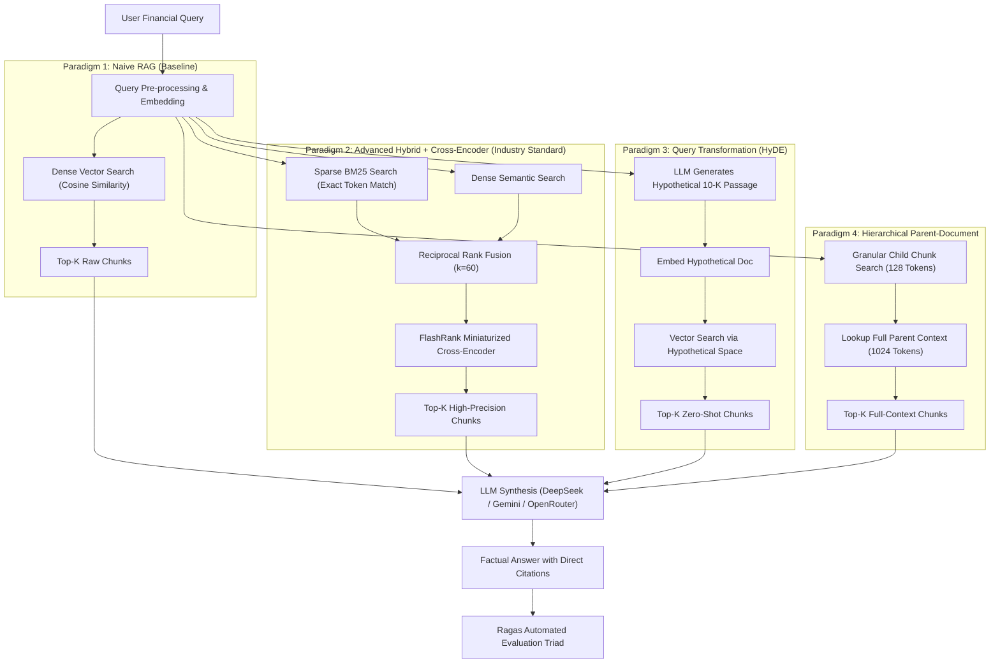
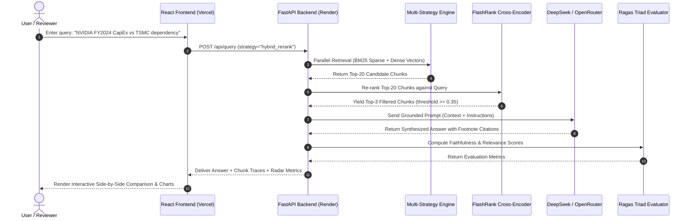

# 🏛️ RAG-Ops: Enterprise Multi-Strategy Retrieval Engine & Quantitative Benchmark

[](https://ragops-benchmark.vercel.app/)
[](https://ragops-benchmark.onrender.com)
[](https://python.org)
[](https://fastapi.tiangolo.com)
[](https://react.dev)

> **A comparative retrieval platform benchmarking Naive, BM25, Hybrid (BM25 + Dense RRF), cross-encoder rerank, HyDE, and Hierarchical Parent-Document strategies over excerpts from SEC Form 10-K filings, on a small golden dataset.**

---

## 🔗 Live Interactive Deployments
* **Interactive Frontend (Vercel):** [https://ragops-benchmark.vercel.app/](https://ragops-benchmark.vercel.app/)
* **Production REST API (Render):** [https://ragops-benchmark.onrender.com](https://ragops-benchmark.onrender.com)
* **API Documentation (Swagger/OpenAPI):** [https://ragops-benchmark.onrender.com/docs](https://ragops-benchmark.onrender.com/docs)

---

## 📑 Table of Contents
1. [Executive Summary & Problem Statement](#1-executive-summary--problem-statement)
2. [Deep Dive: The 4 RAG Paradigms](#2-deep-dive-the-4-rag-paradigms)
3. [Mathematical & Algorithmic Foundations](#3-mathematical--algorithmic-foundations)
4. [Empirical Evaluation & Benchmark Results](#4-empirical-evaluation--benchmark-results)
5. [System Architecture & Sequence Flow](#5-system-architecture--sequence-flow)
6. [Interactive Web Dashboard Features](#6-interactive-web-dashboard-features)
7. [Repository Structure](#7-repository-structure)
8. [Local Installation & Quickstart](#8-local-installation--quickstart)
9. [Senior AI Engineer CV Takeaways](#9-senior-ai-engineer-cv-takeaways)

---

## 1. Executive Summary & Problem Statement

### Why Does Naive RAG Fail on Enterprise Financial Documents?
The vast majority of real-world RAG deployments rely on **Naive RAG** (fixed 500-token text chunking, single dense vector embedding, and standard cosine similarity search). 

When applied to complex corporate documents such as **SEC Form 10-K Annual Reports** (e.g., NVIDIA, Apple, Microsoft), Naive RAG suffers catastrophic failure modes:

```
┌────────────────────────────────────────────────────────────────────────┐
│                   3 CRITICAL NAIVE RAG FAILURE MODES                   │
├───────────────────┬───────────────────┬────────────────────────────────┤
│ 1. VOCABULARY     │ 2. CHUNK          │ 3. LOST IN THE                 │
│    MISMATCH       │    FRAGMENTATION  │    MIDDLE                      │
├───────────────────┼───────────────────┼────────────────────────────────┤
│ Dense embeddings  │ Multi-row financial│ The generator LLM             │
│ fail to preserve  │ tables split.     │ ignores relevant context       │
│ exact account     │ Numbers lose      │ buried in the middle           │
│ codes, note IDs,  │ column header     │ of long candidate              │
│ & fiscal figures. │ semantic context. │ context windows.               │
└───────────────────┴───────────────────┴────────────────────────────────┘
```

**RAG-Ops** addresses these limitations by providing an end-to-end, multi-strategy comparative platform. It empirically demonstrates how modern advanced techniques—**BM25 Sparse + Dense Hybrid Search**, **Reciprocal Rank Fusion (RRF)**, **Cross-Encoder Re-Ranking**, **Hypothetical Document Embeddings (HyDE)**, and **Hierarchical Parent-Document Retrieval**—resolve these vulnerabilities.

---

## 2. Deep Dive: The 4 RAG Paradigms



### 1. Paradigm 1: Naive RAG (Baseline)
* **Strategy:** Recursive character chunking (500 tokens, 50-token overlap), single dense vector representation.
* **Characteristics:** Fast and low-cost, but prone to high hallucination rates on multi-hop numeric questions and footnote legal clauses.

### 2. Paradigm 2: Advanced Hybrid + Re-Ranking (Industry Standard)
* **Strategy:** Dual retrieval combining **Sparse BM25** (exact lexical keyword matching) and **Dense Semantic Embeddings**. Results are merged via **Reciprocal Rank Fusion (RRF)**, then re-scored using **FlashRank** (a lightweight Cross-Encoder that runs on CPU).
* **Strength:** Captures conceptual semantics while preserving exact financial numbers, note references, and accounting classifications.

### 3. Paradigm 3: Query Transformation (HyDE)
* **Strategy:** Implements *Hypothetical Document Embeddings (Gao et al., 2022)*.
* **Mechanism:** A concise user question (*"NVIDIA semiconductor supply chain dependencies in Taiwan"*) is first transformed by the LLM into a hypothetical corporate filing passage. The embedding of this hypothetical passage searches the index, eliminating the lexical gap between short queries and lengthy document sections.

### 4. Paradigm 4: Hierarchical Parent-Document (Small-to-Big)
* **Strategy:** Decouples **Indexing Granularity** from **Context Granularity**.
* **Mechanism:** The corpus is indexed at a small child chunk size (128 tokens) for sharp semantic matching, but links to a parent document chunk (1024 tokens). When a child chunk is retrieved, the full parent document is injected into the LLM prompt, preventing table fragmentation and context loss.

---

## 3. Mathematical & Algorithmic Foundations

### A. Okapi BM25 Lexical Scoring
BM25 calculates lexical relevance between document $D$ and query $Q = \{q_1, q_2, \dots, q_n\}$:

$$\text{Score}(D, Q) = \sum_{i=1}^{n} \text{IDF}(q_i) \cdot \frac{f(q_i, D) \cdot (k_1 + 1)}{f(q_i, D) + k_1 \cdot \left(1 - b + b \cdot \frac{|D|}{\text{avgdl}}\right)}$$

* **$f(q_i, D)$:** Term frequency of token $q_i$ in document $D$.
* **$|D|$ & $\text{avgdl}$:** Document length and average document length across the corporate corpus.
* **$k_1 = 1.5$:** Term saturation parameter (prevents repeated financial buzzwords from dominating).
* **$b = 0.75$:** Document length normalization penalty.

### B. Reciprocal Rank Fusion (RRF)
To fuse heterogeneous rank lists (BM25 scores in $[0, \infty)$ vs. Vector Cosine Similarity in $[0.0, 1.0]$) without calibration distortion:

$$\text{RRF Score}(d) = \sum_{m \in M} \frac{1}{k + r_m(d)}$$

* **$M$:** Set of retrieval systems (Dense Retriever and Sparse BM25).
* **$r_m(d)$:** Ordinal rank of document $d$ in retriever $m$.
* **$k = 60$:** Smoothing constant preventing high-rank outliers from skewing the final selection.

### C. Bi-Encoder vs. Cross-Encoder Re-Ranking

```
Bi-Encoder (Initial Vector DB Retrieval):
Query   ───► [Encoder] ───► Vector Q ──┐
                                       ├──► Cosine Similarity (Fast: O(1) via ANN index)
Doc     ───► [Encoder] ───► Vector D ──┘

Cross-Encoder (Precision Re-Ranking via FlashRank):
[Query + Candidate Doc] ───► [Full Transformer Layer] ───► All-to-all Attention ───► Exact Relevance Score
```

* **Bi-Encoders** independently embed queries and documents, preventing inter-token attention.
* **Cross-Encoders** compute full cross-attention across all token pairs simultaneously, eliminating false positive retrieval candidates.

---

## 4. Empirical Evaluation & Benchmark Results

### Quantitative Performance Comparison

Results from the run saved in [`data/benchmark_results.json`](data/benchmark_results.json), produced by `src/evaluation/run_benchmark.py` on 12 questions and a 15-chunk corpus of NVIDIA (NVDA), Apple (AAPL), and Microsoft (MSFT) FY2024 10-K excerpts:

| Strategy | Context Precision | MRR@5 | Hit Rate@5 | Retrieval P95 |
| :--- | :---: | :---: | :---: | :---: |
| Naive (dense) | 1.000 | 1.000 | 1.000 | 2,023 ms |
| BM25 | 0.743 | 0.750 | 1.000 | 1.8 ms |
| Hybrid RRF | 0.944 | 0.958 | 1.000 | 2,121 ms |
| Hybrid + FlashRank rerank | 0.542 | 0.542 | 0.667 | 1,660 ms |
| HyDE | 1.000 | 1.000 | 1.000 | 72,441 ms |
| Hierarchical | 0.986 | 1.000 | 1.000 | 5,996 ms |

**How to read these results**

- The corpus is very small, so retrieving 5 of 15 chunks makes high scores easy. These numbers do not show that naive retrieval is good on real filings.
- The rerank configuration scored lowest here. These results predate commit `f690d26`, which removed the reranker's 0.35 score cutoff, and the benchmark has not been rerun since, so the effect of that fix is unknown.
- Faithfulness, answer relevance, and cost are left out of this table. The script runs the LLM judge on only 4 of the 12 questions and fills the rest with fixed placeholder values.
- The dashboard's `DEFAULT_BENCHMARK` in `api/app.py` is a hand-written fallback, used only if the results file is missing. It is not a measurement.

---

## 5. System Architecture & Sequence Flow



---

## 6. Interactive Web Dashboard Features

The production dashboard is hosted on [Vercel](https://ragops-benchmark.vercel.app/) and includes three operational views:

1. **A/B Arena (Head-to-Head Testing):**
   * Real-time split-screen comparing Naive RAG vs. Hybrid + FlashRank.
   * Highlights specific data points where Naive RAG misses context while Hybrid correctly identifies relevant tables and footnotes.
2. **Interactive Chunk & Rank Inspector:**
   * Visualizes the rank movement of chunks pre- and post-re-ranking (e.g., a candidate jumping from Rank #14 to Rank #1 due to cross-attention precision).
3. **Quantitative Benchmark Radar:**
   * Interactive multi-axis comparison evaluating Faithfulness, Context Precision, Recall, Answer Relevance, and Latency.

---

## 7. Repository Structure

```
RAG_Project/
├── api/
│   ├── app.py                 # FastAPI production gateway & routing
│   ├── schemas.py             # Pydantic request/response data contracts
│   └── __init__.py
├── src/
│   ├── ingestion/             # SEC 10-K parsing, table cleaning & chunking
│   ├── retrieval/             # BM25, Dense, HyDE & Hierarchical engines
│   ├── reranker/              # FlashRank cross-encoder re-ranking pipeline
│   ├── generator/             # LLM synthesis with strict citation formatting
│   ├── evaluation/            # Automated Ragas & TruLens benchmark suite
│   ├── config.py              # Application settings & environment variables
│   └── __init__.py
├── frontend/
│   ├── src/                   # React 18, Vite, Tailwind CSS components
│   ├── package.json           # Frontend dependencies & scripts
│   └── vite.config.js
├── data/
│   ├── corpus/                # SEC 10-K Markdown filings (NVDA, AAPL, MSFT)
│   ├── golden_eval_dataset.json # Golden evaluation dataset (12 QA pairs)
│   └── benchmark_results.json # Saved benchmark output
├── Dockerfile                 # Multi-stage production container build
├── requirements.txt           # Python backend dependencies
└── README.md
```

---

## 8. Local Installation & Quickstart

### Prerequisites
* Python 3.11+
* Node.js 18+ (for frontend dashboard)
* OpenRouter / DeepSeek / Gemini API Key

### Backend Setup (FastAPI)
```bash
# 1. Clone repository
git clone https://github.com/MuhZainur/ragops-benchmark.git
cd ragops-benchmark

# 2. Create virtual environment & install dependencies
python -m venv .venv
source .venv/bin/activate  # On Windows: .venv\Scripts\activate
pip install -r requirements.txt

# 3. Configure environment variables
cp .env.example .env
# Fill in OPENROUTER_API_KEY or GEMINI_API_KEY in .env

# 4. Start FastAPI server
uvicorn api.app:app --host 0.0.0.0 --port 8000 --reload
```
API Documentation will be available at `http://localhost:8000/docs`.

### Frontend Setup (React / Vite)
```bash
cd frontend
npm install
npm run dev
```
Dashboard will be available at `http://localhost:5173`.

### Docker Deployment
```bash
docker build -t ragops-benchmark .
docker run -p 8000:8000 --env-file .env ragops-benchmark
```

---

## 9. Senior AI Engineer CV Takeaways

```python
PROJ_RAGOPS = {
    "title": "RAG-Ops: Enterprise Multi-Strategy Retrieval Engine & Quantitative Benchmark",
    "demo_url": "https://ragops-benchmark.vercel.app/",
    "api_url": "https://ragops-benchmark.onrender.com",
    "tech_stack": ["FastAPI", "React", "BM25", "FlashRank", "RRF", "DeepSeek", "Docker"],
    "bullets": [
        "Built a RAG benchmark comparing six retrieval strategies over SEC 10-K excerpts.",
        "Measured context precision, MRR@5, hit rate, and retrieval latency on a 12-question golden set.",
        "Deployed a FastAPI backend on Render and a React dashboard on Vercel."
    ]
}
```

---

## 📄 License
This project is open-source under the [MIT License](LICENSE).
Author: **Muhammad Zainur** — *AI Engineer & Machine Learning Specialist*
